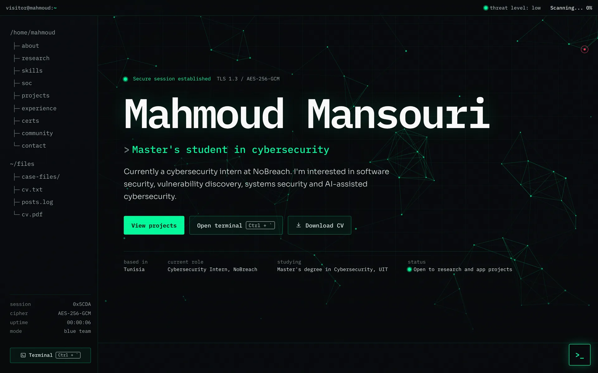

# Mahmoud Mansouri, portfolio

The source of my personal website: who I am, what I have built, my CV and what I share on LinkedIn.

I am a software engineer and a Master's student in cybersecurity at Université Internationale de Tunis (UIT), currently a cybersecurity intern at NoBreach. I am looking for a research internship or a Master's thesis as a pathway toward a PhD in cybersecurity, and I am also open to building web and mobile apps.



## What is on the site

| Page | What it shows |
| --- | --- |
| Home | An operator profile, research interests, a skill audit with the technologies my projects use most, a simulated SOC dashboard, featured case files, a career log, certifications as access badges, community work and a contact form |
| `/projects` | 18 projects as case files, with search, category filters (Web, Mobile, AI, Security, DevOps) and a filter by technology, for example `/projects?stack=Spring%20Boot`. Each card opens a short case report |
| `/projects/[slug]` | A full case file for each project: the problem, the approach, the engineering highlights, screenshots that open in a viewer, the stack, testing, results and related projects |
| `/cv` | The full CV on one printable page: profile, experience, education, certifications, skills and languages |
| `/cv.pdf` | The same CV as a two-page PDF, with a link to each selected project's case study, generated from the same data when the site is built |
| `/posts` | 18 LinkedIn posts grouped by year and filtered by kind, each linking to the original post |

Press Ctrl+` anywhere on the site, or the `>_` button, to open a terminal. Type `help` to list its commands: it moves between sections, prints my profile and skills, opens case reports with `open <n>`, downloads the CV and hides a small capture-the-flag challenge. On a phone it shows the commands as buttons.

## Built with

- [Next.js 16](https://nextjs.org) with the App Router, and React 19
- TypeScript in strict mode
- Plain CSS in `src/app/globals.css` for a dark, terminal-style design, and a small script without dependencies for the animations: the boot screen, the network behind the hero, typed text, the SOC dashboard, the filters, the 3D badges and the terminal. Every animation stops for people who ask their system for less motion
- [pdf-lib](https://pdf-lib.js.org) to build the PDF CV
- The IBM Plex Mono and Sora typefaces, and icons drawn as inline SVG

## How it is made

- **One source for every word.** All the text, numbers, links and image paths live in typed files in `src/data`. The pages, the terminal and the PDF CV all read from them, so they never disagree.
- **Server first.** Every page is rendered on the server with all of its content, so it reads fine before any script runs. The script in `src/lib/console/runtime.js` then adds the animations, the filters, the terminal and the screenshot viewer, and cleans up after itself when you change page.
- **Accessible.** A skip link, visible keyboard focus, labelled controls, dialogs that work from the keyboard, and the boot screen and animations skipped for people who ask for less motion.
- **Works on every screen.** Every page has a phone layout. Screenshots in the case studies open in a viewer that zooms, scrolls long pages and moves between pictures with the arrow keys or a swipe.
- **Light pages.** The screenshots are WebP files sized for the web, about six times smaller than the original PNG captures.
- **Locked down.** In production every page sends a content security policy that only allows the site's own scripts, styles, fonts and images (inline scripts are allowed because Next.js needs them for static pages), and blocks plugins, framing and form posts elsewhere. It also sends `X-Content-Type-Options`, `X-Frame-Options`, `Referrer-Policy`, `Permissions-Policy` and `Cross-Origin-Opener-Policy`. The headers are set in `next.config.ts`, and `public/.well-known/security.txt` says where to report a security issue.
- **Shareable.** Each page has its own title, description and link preview image. Every project gets its own preview card with its name and stack, and the site has a sitemap and structured data for search engines.

## Project structure

```text
src/
  app/          routes: home, projects, project pages, CV, PDF CV, posts, 404
  components/   the home sections, the console chrome (file tree, status bar, terminal, dialogs), case cards and the CV
  data/         all the content, in typed files
  lib/          the PDF builder, the console runtime and content helpers, and formatting helpers
  types/        the shared data types
public/images/  the avatar and the project screenshots
docs/           the pictures used in this README
```

## Run it locally

You need Node.js 20.9 or newer.

```bash
npm install
npm run dev
```

Then open the address printed in the terminal, usually http://localhost:3000.

| Command | What it does |
| --- | --- |
| `npm run dev` | Starts the development server |
| `npm run build` | Builds the production site |
| `npm run start` | Serves the production build |
| `npm run lint` | Runs ESLint |

## Change the content

| File in `src/data` | What it holds |
| --- | --- |
| `site.ts` | Site name, description, address and CV file name |
| `profile.ts` | Name, headline, bio, focus areas, availability, GitHub and LinkedIn links |
| `now.ts` | What I am doing now, and the last updated date |
| `experience.ts`, `education.ts` | Internships, roles, degrees and schools |
| `projects.ts` | Projects, their categories and their case studies |
| `research.ts` | Research interests and what I am looking for |
| `certifications.ts` | Certifications, course certificates and learning paths |
| `community.ts`, `posts.ts` | Community roles and events, and LinkedIn posts |
| `skills.ts`, `languages.ts`, `timeline.ts` | Skills, spoken languages and the timeline |
| `console.ts` | The terminal-style wording: section commands and titles, the typed headlines, badge styles, the SOC dashboard labels and the boot lines |
| `navigation.ts`, `sections.ts`, `ui.ts` | Menus, section titles and interface labels |

To add a project, add an entry to `projects.ts` and put its pictures in `public/images/projects/<slug>/`.

## Deployment

The site is deployed on [Vercel](https://vercel.com) from this repository. Every push builds and publishes a new version.

## Contact

- LinkedIn: [Mahmoud Mansouri](https://www.linkedin.com/in/mahmoud-mansouri-6548b41b6/)
- GitHub: [MahmoudMans](https://github.com/MahmoudMans)
